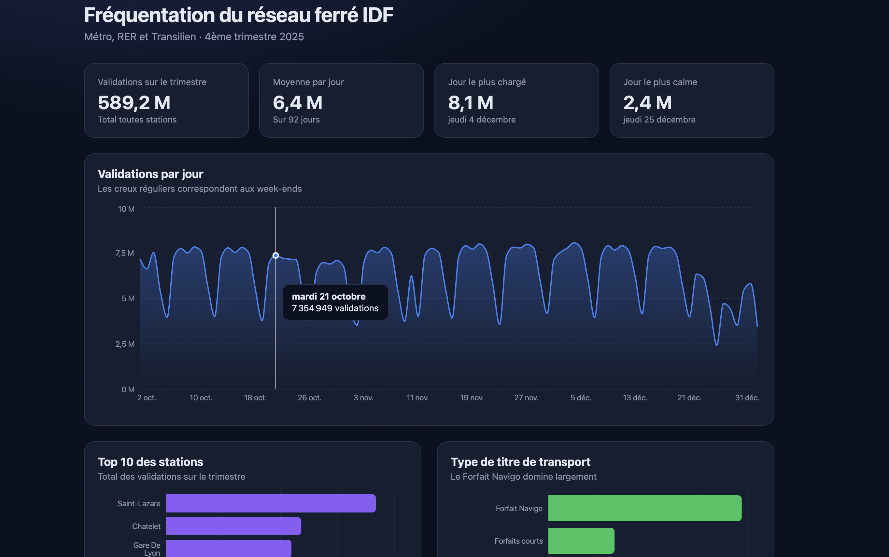

# Dashboard de fréquentation du réseau ferré IDF

Dashboard interactif construit à partir des données ouvertes d'Île-de-France Mobilités : nombre de validations par jour, par station et par type de titre de transport (4ème trimestre 2025, ~480 000 lignes).



## Architecture

```
CSV (open data) → Python / pandas → SQLite → API FastAPI → React / Recharts
```

| Dossier | Rôle |
|---|---|
| `etl/` | Nettoyage des données (pandas) et chargement dans SQLite |
| `api/` | API REST FastAPI qui interroge la base en SQL |
| `frontend/` | Application React avec graphiques Recharts |

## Technologies

Python, pandas, SQLite, FastAPI, React, Vite, Recharts

## Ce que j'ai appris

- Nettoyer un jeu de données réel avec pandas (types, noms de colonnes, valeurs)
- Concevoir un schéma SQL : tables `arrets` et `validations`, clés, index
- Détecter un défaut de modélisation : un `code_arret` n'est pas unique, j'ai donc utilisé une clé artificielle sur le couple `(code_arret, id_zdc)`
- Vérifier l'intégrité du chargement : le total des validations est identique avant et après (589 213 134)
- Exposer des routes REST paramétrées (requêtes préparées) avec FastAPI
- Construire des composants React réutilisables

## Lancer le projet

*(à compléter à l'étape suivante)*

## Source des données

Île-de-France Mobilités, « Validations sur le réseau ferré : nombre de validations par jour » (open data).